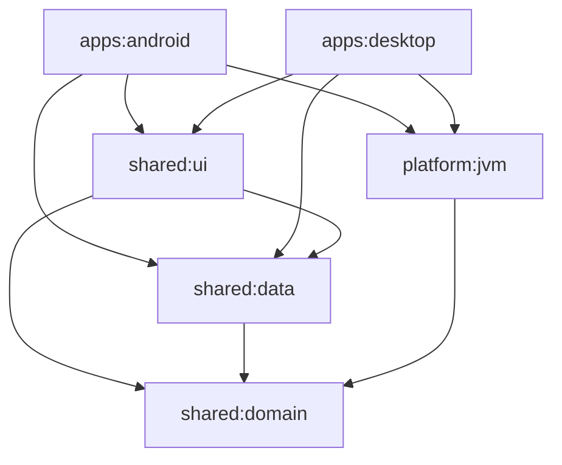

# 目录结构与模块边界

## 三个阶段的对比

原 Android 工程将 154 个生产 Kotlin 文件集中在 `app/src/main/kotlin/yancey/chelper` 下，按 `android`、`core`、`data`、`network`、`ui` 分包。这样能在一个模块中直接调用，但 Android Context、持久化、网络和界面之间没有构建边界。

首次跨平台迁移拆出了六个平铺模块：

```text
CHelper-Compose/
├── androidApp/
├── desktopApp/
├── domain/
├── data/
├── core-jvm/
└── shared/
```

共享代码已经复用，但仍有以下结构问题：

| 迁移后的问题                                                  | 本次处理                                                                            |
| ------------------------------------------------------------- | ----------------------------------------------------------------------------------- |
| 入口与共享库在根目录平铺，`shared` 一词同时像总称和 UI 模块名 | 平台入口归入 `apps`，可复用模块归入 `shared`                                        |
| `domain` 下仍有 `ui.rawtext`、`core.Theme`                    | 文档快照归入 `domain.rawtext`，语法配色归入 `ui.designsystem.text`                  |
| 命令草稿与实际仓库契约留在数据实现中                          | 模型、仓库接口和编辑版本规则归入 `domain.command`                                   |
| 命令库模型被放在 `network.library.data`，业务层依赖网络包名   | 业务聚合和兼容序列化模型归入 `domain.library`，网络响应 DTO 留在 `data.remote`      |
| 同步规则与网络调用混放                                        | 同步状态转换和处理器归入 `domain.library.sync`，远端实现留在 `data.library.sync`    |
| 数据模块中有 `ui.library` 包，UI 中又有转发类型别名和包装函数 | 本地文档工具归入 `data.library`，调用方直接使用真正的声明                           |
| 所有命令库页面都在一个大包中，存在 `CPLUser/CPLUpload` 命名   | 按账号、浏览、本地库、上传、收藏、消息等流程分包，使用 `Account/LibraryUpload` 命名 |
| Android 适配器散落在 `data/network/ui/core` 包中              | 统一归入 `yancey.chelper.android`，再按存储、网络、导航、UI 等能力分组              |
| Windows 宿主全部挤在一个包内                                  | 按 `di/platform/storage/instance/network/sync/window` 分组                          |
| 模块重复维护 SDK、JVM 版本和共用源码映射                      | 统一由 `build-logic` 的约定插件维护                                                 |
| 保留了旧桌面工作台未被生产代码使用的仓库接口及测试替身        | 删除未使用抽象，只将旧磁盘 DTO 放在 `data.migration.desktop`                        |

现在仍为六个业务模块；目录分组和包拆分直接表达职责，不为每个页面增加 Gradle 模块。

## 当前结构

```text
CHelper-Compose/
├── apps/
│   ├── android/src/{main,debug,release,test,androidTest}/kotlin/yancey/chelper/android/
│   │   ├── activity/       # Activity 入口
│   │   ├── di/             # Android 依赖组装
│   │   ├── navigation/     # 原生宿主导航包装
│   │   ├── network/        # WebView 适配
│   │   ├── storage/        # 目录、Bitmap、AtomicFile、Keystore
│   │   ├── ui/             # 原生命令编辑、IME 系统操作、验证码适配
│   │   └── service/, window/, widget/, work/, util/
│   └── desktop/src/{main,test}/kotlin/yancey/chelper/desktop/
│       ├── Main.kt
│       ├── di/, platform/, storage/, instance/
│       └── network/, sync/, window/
├── shared/
│   ├── domain/src/commonMain/kotlin/yancey/chelper/domain/
│   │   └── assets/, auth/, command/, enumeration/, history/, library/, rawtext/, settings/
│   ├── data/src/commonMain/kotlin/yancey/chelper/data/
│   │   ├── local/          # DataStore 集合、各存储与存储迁移
│   │   ├── library/        # 文档工具、仓库实现、远端同步
│   │   ├── remote/         # Ktor 服务、请求策略、WAF 与响应 DTO
│   │   └── auth/, background/, logging/, mcd/, migration/, policy/, startup/
│   └── ui/src/commonMain/kotlin/yancey/chelper/ui/
│       ├── app/            # 应用根节点、依赖与关闭写入协调
│       ├── navigation/     # 统一路由图、路由键与分享链接
│       ├── platform/       # UI 所需的宿主能力接口
│       ├── designsystem/   # 主题、控件、布局、对话框和文本展示
│       └── feature/
│           ├── home/, command/, conversion/, enumeration/
│           ├── rawtext/, loongflow/, settings/, about/, document/
│           └── library/
│               ├── account/, browse/, local/, upload/, favorites/, messages/
│               └── activity/, profile/, score/, search/, mcd/, components/
├── platform/jvm/src/{main,test}/kotlin/yancey/chelper/
│   ├── core/           # 保留 JNI ABI 的六个类型
│   └── nativecore/     # JNI 适配、Crunch 枚举、动态库和 OkHttp 传输
├── build-logic/
├── resources/
└── gradle/
```

生产代码的包名必须与模块归属、`src/<sourceSet>/kotlin` 后的路径一致。测试放在被测代码所属模块，保持相同包名或明确的测试子包。纯模型和协议兼容测试归属 `domain`；网络协议和文档工具测试归属 `data`；格式化展示和 ViewModel 测试归属 `ui`；系统能力测试归属相应宿主。

## 依赖方向



`domain` 不依赖 Compose、Android、Java IO、数据实现或 JNI。`data` 不依赖 UI 或原生引擎。`platform/jvm` 不依赖 UI 或数据实现。domain、data、ui 的共享生产实现全部位于 `commonMain`，测试全部位于 `commonTest`，不引用 Java、JUnit、Retrofit、OkHttp 或 JNI 类型。命令会话、建议惰性读取和生命周期规则属于 domain；JNI 适配器映射为领域结果对象，由宿主注入引擎工厂和枚举仓库。

Android / Windows 的系统适配分别放在宿主内；共享模块不得引用宿主包。普通功能界面、IME 指引内容与撤回按钮、编辑逻辑、数据格式与同步规则只保留一份实现。平台宿主通过 `ClientServices` 和 `ClientPlatform` 组装实际能力。

共享交互入口位于 `ui/commonMain/platform`。每个 Activity / Window / 浮窗内容根使用 `ClientInteractionHost` 接入宿主的 Navigation Event dispatcher；标题栏通过官方 `DirectNavigationEventInput` 请求返回，功能页用 `NavigationBackHandler` 的薄封装注册业务守卫。Escape 交给 Compose Window 默认处理，不在生产根节点拦截按键或强制恢复焦点。`LocalAppBackAction` 仅供确认离开后的直接导航。Android 系统浮窗保留原生按键转发和 ViewTree owner 适配。

弹窗统一由共享 `AppDialogHost` 绘制在当前 Compose 宿主内，不创建系统 Dialog 窗口。`AppDialog` 保留调用点的 CompositionLocal 与内容状态，支持嵌套、返回优先级、遮罩拦截和焦点恢复；`AppAlertDialog` 复用同一个宿主和自有 Foundation 内容控件。Android 普通页面、系统浮窗和 Desktop 共用该实现，不再维护 Dialog windowType 适配。

外部网页通过官方 LocalUriHandler 打开；界面剪贴板通过 LocalClipboard 挂起 API 读写，仅由 Android/Windows 宿主注入纯文本 ClipEntry 编解码器。ClientPlatform 不再提供 URL、命令编辑器或普通剪贴板入口。ClientMessages 是共享反馈入口：Android 在 Application 初始化时安装 Toaster 呈现器；Desktop 使用共享 Foundation 消息组件，支持瞬时事件、生命周期取消、手动关闭、live region 和可访问性超时。不同时向两端呈现机制发送同一消息。保留原因见[采用记录](official-compose.md#toaster-保留依据)。

普通控件使用项目自己的主题与 Foundation 设计组件，禁止 Material / Material 3 组件和依赖。普通输入和安全密码输入分别使用 BasicTextField 与 BasicSecureTextField，共用装饰器；命令编辑保留领域规则、语法样式和错误范围。所有预览使用统一注解和纯 Content，放在 commonMain，不创建真实仓库或业务 ViewModel。详细约束见[Compose 基础能力采用记录](official-compose.md)和根目录 AGENTS.md。

`yancey.chelper.core` 是唯一保留的历史命名空间例外：C++ 使用 JNI 类名和字段签名访问 `CHelperCore`、`CommandContext`、`ClickSuggestionResult`、`ErrorReason`、`SelectedString`、`Suggestion`。其余原生实现均放在 `nativecore`，不能继续向 ABI 包添加业务实现。

## 源码集与构建约定

`commonMain/commonTest` 使用标准 KMP 源码集。删除自定义 JVM 共享目录及其重复编译映射。共享测试使用 `kotlin.test`，由标准 `jvmTest` 和 `testAndroidHostTest` 任务执行；协程调度使用 `kotlinx-coroutines-test`，存储测试使用 Okio FakeFileSystem，HTTP 契约测试使用 Ktor MockEngine。真实 JNI、系统窗口、操作系统文件与浏览器集成测试留在对应平台模块。

构建约定只有两个：`chelper.multiplatform-library` 管理 Android / JVM 目标、SDK、JVM 17 与公共测试；`chelper.jvm-library` 管理平台适配和桌面宿主的 JVM / Java 17 配置。`platform/jvm` 为两个宿主复用一份真实 JVM 适配，不向共享模块暴露 Java 类型。

网络通过应用容器持有的 `NetworkServices` 实例组装，并通过 `ClientServices`、仓库构造参数和后台任务入口注入。不可变 `NetworkConfig` 固定服务地址与调试开关；`LoginSession`、`GuestSession`、云端内存缓存和 `BrowserVerificationState` 都属于该应用实例，不使用可变全局注册表。

认证客户端不调用自动令牌获取；业务客户端通过 `TokenProvider` 优先取正式账号令牌，再取访客令牌。两类客户端共享限流和浏览器验证状态，关闭应用时取消请求并释放各自引擎。Android WebView 在主线程创建、销毁，只更新验证 Cookie；Windows 使用官方 Ktor WebSockets 连接独立 Edge 配置的 CDP，保留启动交接、取消、等待者异常完成和进程清理。

JSON 使用官方 ContentNegotiation 和类型化请求／响应；保留已存在的 text/plain JSON 响应兼容。HTTP 调试日志使用 Ktor Logging 接入现有日志入口，不记录正文，删除 URL 查询与片段，并脱敏认证／Cookie 头。OkHttp 引擎只维护 TLS、HTTP/2、Brotli、超时和 10 MiB 磁盘缓存；缓存仅服务公开资源，认证、私有命令库和 WAF 请求使用 no-store；Windows 上 OkHttp 的读取文件锁可能阻止 304 元数据立即写回，后续请求可再次重验证，但缓存正文仍按 304 正确恢复，不自行绕过文件锁或替换缓存实现；Coil 图片缓存保持独立。

访客签名使用 cryptography-kotlin 的 ECDSA P-256 / SHA-256，保留 PKCS#8 密钥和 DER 签名协议。时间使用 Kotlin Clock / Instant 和 kotlinx.datetime。

七项存储都通过 OkioStorage 读取相同路径和格式；宿主只提供 Okio Path。历史 Java modified UTF-8 草稿由公共兼容解码器读取，包含 NUL 和 UTF-16 代理对；新草稿继续使用原有大端长度和 UTF-8 格式。需要等待关闭时调用 `closeAndJoin()`，公共 `use` 在不可取消的清理阶段等待文件句柄释放。

共享图片和字符串遵循 Compose 标准目录 `shared/ui/src/commonMain/composeResources`。Android 原生资源访问也映射到这份目录。`resources` 只保存内核资源、内置文档和 Rawtext 索引；安装器、原生库输出分别由平台模块维护。

## 保持兼容与执行检查

这次重构不改变 Android 应用 ID、已注册入口组件、JNI ABI、历史数据目录、JSON 字段、命令草稿二进制格式或分享 URI。签名配置仍从根目录读取；相对密钥路径优先保留迁移前指向的文件，密钥随模块移动时按新位置解析，本次迁移不改写签名配置内容。导航路由通过显式 `SerialName` 保留迁移前的序列化标识，避免包名变化改变已保存的目标 ID。Gradle 模块路径、Kotlin 包名、构建脚本、CI 产物路径和 IDE 模块配置一起迁移，不保留旧模块或转发别名。

`check_compose_architecture.py` 检查依赖方向、包名归属、文件路径、共享源码对宿主的引用、JNI 包白名单、DataStore 创建边界、重复 JVM 文件类和共享资源兼容性。`format_compose.py` 遍历维护中的源码与构建约定，调用保留版权头的格式化器。构建、测试与打包命令见上级 [README](../README.md)。
